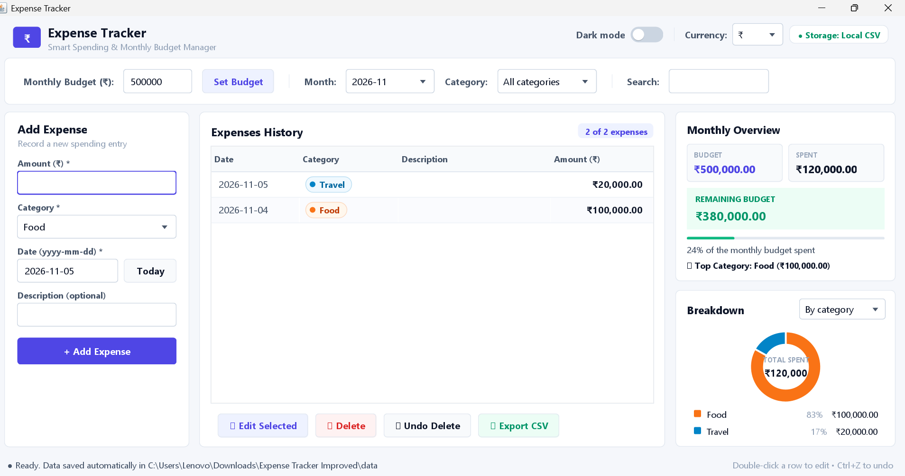

# Expense Tracker

A desktop app for tracking your monthly spending, built with Java Swing. No database and no external libraries: your data is saved automatically in plain files next to the app.



## Features

- **Monthly budget** with a progress bar, the amount remaining, and a warning colour when you are close to or over the limit
- **Budget alerts**: a popup warns you when you reach 80% of the month's budget and when you go over it
- **Add, edit and delete** expenses (double-click a row to edit)
- **Undo delete** with the button or `Ctrl+Z`
- **Filter** by month and category, and **search** by description, category or amount
- **Sort** the table by clicking any column header
- **Charts**: a donut chart of spending per category, and a bar chart that compares the last 6 months (switch with the "By category / By month" menu)
- **Light and dark mode**: slide the switch at the top right; your choice is remembered
- **Currency choice**: ₹, $, € or £ (saved with your settings)
- **Scroll bars** appear when the window is small, so you can always reach everything
- **Saved automatically**: close the app and your expenses are still there next time
- **Export to CSV** (opens in Excel or Google Sheets)
- Input checks with clear messages: wrong amounts and dates never crash the app

## Requirements

Java 11 or newer (JDK to build, JRE to run). Check with `java -version`.

## Run it

The easiest way: double-click `run.bat` (Windows) or run `./run.sh` (Linux and macOS). It builds the app and starts it.

Or do it by hand from the project folder.

Linux and macOS:

```bash
mkdir -p out
javac -encoding UTF-8 -d out src/expensetracker/*.java
java -cp out expensetracker.Main
```

Windows (Command Prompt):

```bat
mkdir out
javac -encoding UTF-8 -d out src\expensetracker\*.java
java -cp out expensetracker.Main
```

Keep `-encoding UTF-8`: it makes sure symbols like ₹ compile correctly on Windows.

### Run the ready-made jar

`dist/expense-tracker.jar` is a prebuilt copy (Java 11 or newer). Double-click it, or run:

```bash
java -jar dist/expense-tracker.jar
```

Your data is saved in a `data` folder next to where you start it.

### Build the jar yourself

```bash
mkdir -p build dist
javac -encoding UTF-8 -d build src/expensetracker/*.java
jar --create --file dist/expense-tracker.jar --main-class expensetracker.Main -C build expensetracker
```

## Where your data is stored

In a folder named `data` inside the project folder (the folder you run the app from), so it is easy to find and open in Excel:

| File | Contents |
| --- | --- |
| `expenses.csv` | One line per expense: date, category, description, amount |
| `settings.properties` | Your monthly budget, currency and light/dark mode |

To use a different folder, start the app with `-Dexpensetracker.home=/some/folder`.
To back up or move your data, copy that folder. Data from the older version (`.expense-tracker` in your home folder) is copied over automatically the first time.

The `data` folder is listed in `.gitignore`, so your personal expenses are never pushed to GitHub.

## Run the tests

The checks for saving, loading, totals, monthly totals, currency and theme need no test library:

```bash
javac -encoding UTF-8 -d out src/expensetracker/*.java test/expensetracker/*.java
java -ea -cp out expensetracker.ExpenseStoreTest
```

## Project structure

```
src/expensetracker/
  Main.java            starts the app
  MainFrame.java       the window: filters, form, table, summary, budget alerts
  UITheme.java         light and dark colours, fonts, buttons, drop-downs, table and scroll bars
  ToggleSwitch.java    the sliding light/dark switch
  ChartPanel.java      donut chart of spending per category (Java 2D)
  MonthlyBarChart.java bar chart comparing the last 6 months (Java 2D)
  ExpenseStore.java    loads, saves and calculates totals
  Expense.java         one spending entry
test/expensetracker/
  ExpenseStoreTest.java
docs/
  screenshot.png
dist/
  expense-tracker.jar  prebuilt app
run.bat / run.sh       build and start in one step
```


## Ideas for the future

- Import expenses from a CSV file
- Recurring expenses such as rent or subscriptions
- Separate budgets per category
- Income tracking and savings goals

## License

MIT. See [LICENSE](LICENSE).
